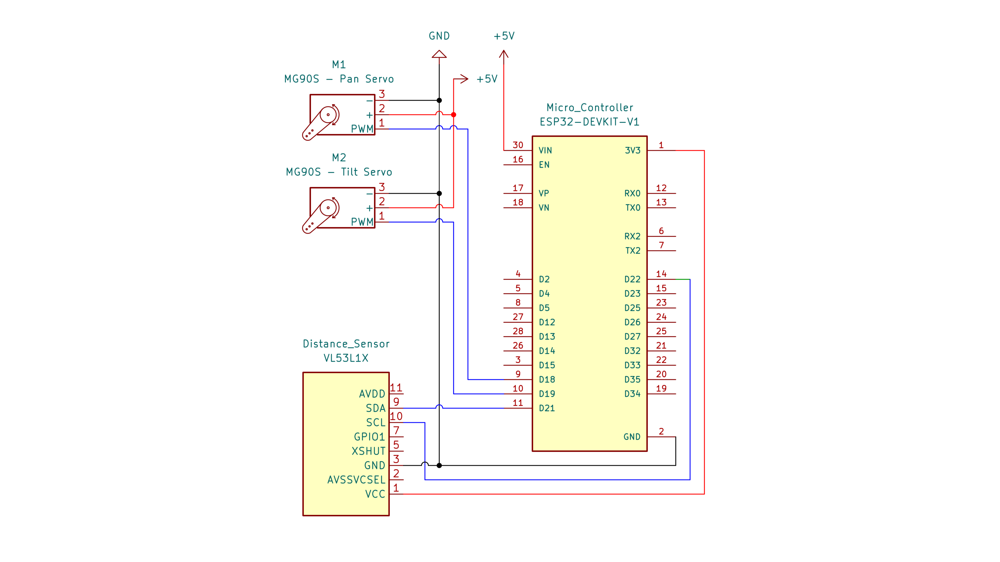

# Pan-tilt Head Tracking Camera
### Yolo26s | Mediapipe | MG90S servo | ESP32DEVKITV1


A two-axis (pan-tilt) camera gimbal that performs **real-time head detection and closed-loop visual servoing** to keep a target centered in the field of view. Perception (detection, tracking, landmark extraction) runs on a GPU-equipped laptop, while low-level actuation (PID control of two servos) runs on an ESP32 microcontroller, linked over a wired serial channel. This project was developed as a coursework project for *Measurement and Control*.

## Demo Video

[//]: # (Video demo)

---

## Table of Contents

1. [Key Features](#key-features)
2. [System Architecture](#system-architecture)
3. [Hardware](#hardware)
4. [Mechanical Design](#mechanical-design)
5. [Wiring](#wiring)
6. [Software Stack](#software-stack)
7. [Installation](#installation)
8. [Serial Protocol](#serial-protocol)
9. [Control GUI](#control-gui)
10. [Distance Estimation](#distance-estimation)
11. [Experiments & Known Issues](#experiments--known-issues)
12. [Contributors](#contributors)
13. [License](#license)

---

## Key Features

- **Real-time head detection and multi-object tracking** using **YOLO26s** (Ultralytics, input size `imgsz = 640`), with GPU inference on an RTX 4050 (PyTorch + CUDA 13.0).
- **Visual servoing error computation**: the pixel offset between the bounding-box centroid and the image center (`errX`, `errY`) is streamed to the ESP32 as the control error signal.
- **Onboard PID control** for the pan and tilt axes on the ESP32, with **online gain tuning** from the host over serial, so no firmware reflash is needed during tuning.
- **Desktop GUI** with a PID tuning panel, a live list of tracked object IDs, click-to-lock target selection, and an AUTO fallback mode.
- **MediaPipe face-contour overlay** (facial landmarks → convex hull) rendered on the followed head's bounding box.
- **Dual-source distance measurement**: a TOF400C-VL53L1X time-of-flight (ToF) sensor compared against a monocular camera-based estimate (OpenCV 5).
- All runtime parameters (resolution, FPS, thresholds, COM port, baud rate, etc.) are defined as constants in the source file rather than CLI arguments.

## System Architecture


**Per-frame processing pipeline:**

1. The webcam streams a frame to the host.
2. YOLO26s detects heads and assigns persistent track IDs; the target is selected by the ID-locking policy.
3. The control error is computed as `errX = cx_bbox − cx_frame` and `errY = cy_bbox − cy_frame`.
4. The packet `E,errX,errY,has_target` is sent to the ESP32.
5. The ESP32 runs the PID loop and drives both servos to drive the error toward zero.

This is a **decoupled perception–control architecture**: the compute-heavy, non-real-time inference stays on the host, while the time-critical control loop runs on the microcontroller.

## Hardware

| Component | Details                                                 |
|---|---------------------------------------------------------|
| Host machine | Laptop with an NVIDIA RTX 4050 GPU, running Windows     |
| Camera | External USB webcam, 1080p (advertised 30 FPS)          |
| Microcontroller | ESP32 DevKit V1 (servo control and sensor readout only) |
| Actuators | 2 × MG90S micro servos (pan + tilt)                     |
| Range sensor | TOF400C - VL53L1X ToF sensor (I2C)                      |
| Servo power | AC–DC switching-mode 5V-2A power supply                 |

## Mechanical Design

The pan-tilt mechanism was designed in **SolidWorks (Student Edition)**. The pan axis rotates about the vertical axis, and the tilt axis raises and lowers the camera. Both axes are driven directly by MG90S servos.

### Assembly overview


### Mechanical layout

- **Pan:** rotation about the vertical axis.
- **Tilt:** raises/lowers the camera.
- **Home pose:** `pan = 90`, `tilt = 130`. The gimbal returns home pose when no target is available.

## Wiring

| ESP32 pin | Connected to                            |
|---|-----------------------------------------|
| GPIO18 | Pan servo signal                        |
| GPIO19 | Tilt servo signal                       |
| GPIO21 (SDA) | TOF400C - VL53L1X SDA                   |
| GPIO22 (SCL) | TOF400C - VL53L1X SCL                             |
| 3V3 / GND | TOF400C - VL53L1X VCC / GND                       |
| USB | Host laptop (serial link + ESP32 power) |

- Servos are powered from the **AC–DC switching-mode 5V-2A power supply**, not from the ESP32 pins.
- **Common ground** is required between the power supply, the servos, and the ESP32.
- The TOF400C - VL53L1X was verified with an I2C scanner at address `0x29`.



## Software Stack

**Host (Python 3.13):**

- PyTorch (CUDA 13.0)
- Ultralytics (YOLO26s)
- OpenCV 5 (`opencv-python` and `opencv-contrib-python`, same version 5.0.0.93)
- MediaPipe
- pyserial

**Firmware (ESP32):**

- Arduino IDE (`.ino` sketch)
- Pololu VL53L1X library (v1.3.1)
- An ESP32-compatible servo library

## Installation

### 1. Clone the repository and create a virtual environment

```bash
git clone https://github.com/Secret350/Pan-Tilt-Tracking-Camera.git
cd Pan-Tilt-Tracking-Camera

python -m venv .venv
.venv\Scripts\activate          # Windows
pip install -r requirements.txt --extra-index-url https://download.pytorch.org/whl/cu130
pip install opencv-python==5.0.0.93 opencv-contrib-python==5.0.0.93
```

> ⚠️ **Avoid non-ASCII characters in the project path** (e.g., Vietnamese diacritics): MediaPipe crashes when the path contains them. Use a plain ASCII path such as `E:\pan_tilt_head_tracking_camera`. Also note that renaming or moving the project folder breaks the `.venv`; run `pip freeze > requirements.txt` beforehand and recreate the environment afterwards.

### 2. Flash the ESP32 firmware

1. Open the `.ino` sketch in Arduino IDE.
2. Select the **ESP32 Dev Module** board (ESP32 DevKit V1) and the correct COM port.
3. Install the Pololu VL53L1X library via the Library Manager.
4. Upload the sketch.

### 3. Configure and run

Edit the constants at the top of the main script (COM port, baud rate, resolution, weights path, etc.), then run:

```bash
cd src
python gui.py
```

### Camera backend selection

Benchmarks on Windows with the USB webcam:

- **DSHOW:** applies MJPG only when the FOURCC is set *after* the resolution and FPS; reaches ~26 FPS at all resolutions.
- **MSMF:** ~30 FPS across all modes.
- Neither backend reached 60 FPS, even when 60 was requested.

→ The project uses **MSMF at 1280×720 (~30 FPS)**.

## Serial Protocol

Baud rate **115200**; each message is a newline-terminated ASCII line.

| Direction | Message | Description                                                                                                            |
|---|---|------------------------------------------------------------------------------------------------------------------------|
| Host → ESP32 | `E,errX,errY,has_target` | Pixel error of the bbox centroid relative to the image center; `has_target` is 1 when a target is present, 0 otherwise |
| Host → ESP32 | `P,name,value` | Updates a single PID parameter (e.g., a gain of the pan or tilt controller) at runtime                                 |
| ESP32 → Host | (distance line) | TOF400C-VL53L1X range measurement reported to the host for display and comparison                                      |

## Control GUI

The GUI wraps the original tracking script as its core module and provides:

- **PID tuning panel:** adjust gains in real time to achieve the smoothest possible motion.
- **Tracked-ID list:** live view of all active track IDs.
- **Click-to-lock:** click an ID to make the gimbal follow that specific target.
- **AUTO mode:**
  - If the locked ID changes or disappears and no new target is selected, the system falls back to following the **lowest available ID**.
  - If no IDs remain, the gimbal returns to the **Home pose** (`pan = 90`, `tilt = 130`).

## Distance Estimation

Two independent estimates are shown side by side for comparison:

1. **TOF400C-VL53L1X sensor:** direct range measurement read by the ESP32 over I2C and forwarded to the host. A characterization script measures the sensor's minimum/maximum range and its angular field of view (FoV).
2. **Monocular camera-based estimate (OpenCV 5):** distance inferred from the apparent size of the target in the image.

The goal is to quantify the discrepancy between the two methods across distances.

## Experiments & Known Issues

- **Low throughput (~5 FPS)** in the first run: the driver applied YUY2 instead of the requested MJPG. Resolved by profiling capture backends and switching to MSMF.
- **Jerky motion and overshoot** with naive proportional-style control: addressed by introducing a PID controller and runtime gain tuning over serial.
- **Continuous-rotation behavior on the vertical-axis servo (resolved):** during the sweep test with the initial servo (SG90S), the axis spun multiple full turns and reversed direction. A diagnostic test showed that `write(90)` produced a slow creep, while `write(60)` and `write(120)` spun in opposite directions at roughly equal speeds. This indicated a **continuous-rotation servo** with no absolute position feedback, which cannot be commanded by angle. The issue was resolved by switching to **MG90S positional servos** for both axes, restoring angle-based control.
- **MediaPipe crash** caused by a non-ASCII project path. Resolved by moving to an ASCII-only path.
- **Power supply constraint (resolved):** the initial setup powered the servos from a 4×AA series pack of single-use alkaline cells (no rechargeable NiMH was available), which is subject to voltage sag under servo load and gradual discharge. This was resolved by switching to an **AC–DC switching-mode power supply (SMPS)**, which provides a stable DC supply for the servos independent of battery state.

## Contributors

This project was developed as a coursework project for *Measurement and Control*.

| Name                | Student ID | Role / Responsibilities | GitHub                                          |
|---------------------|------------|---|-------------------------------------------------|
| Nguyễn Đức Minh Trí | 2024602732 | Perception pipeline (YOLO26s, tracking), GUI, serial protocol | [@Secret350](https://github.com/Secret350)      |
| Phùng Xuân Tuân     | 2024602626 | Mechanical design in SolidWorks | [@PhungXuanTuan](https://github.com/PhungXuanTuan) |
| Lê Quang Dũng       | 2024605831 | Electrical wiring, KiCad schematic | _                                               |
**Institution:** Hanoi University of Industry (HaUI)

### Acknowledgements

- [Ultralytics](https://github.com/ultralytics/ultralytics) for YOLO26s
- [Google MediaPipe](https://github.com/google-ai-edge/mediapipe) for face landmark extraction
- [Pololu VL53L1X library](https://github.com/pololu/vl53l1x-arduino) for the ToF sensor driver

## License

Released under the **Apache 2.0** license. See the `LICENSE` file for details.